# Android App Demonstration
## Home Page
The Home Page offers a variety of useful features, including:

* A video list displaying all available videos on the platform.
* A search bar to filter videos by title.
* Options to sign in, edit videos, toggle dark mode, and refresh the page by returning to the Home Page.

# Home Page Views

| 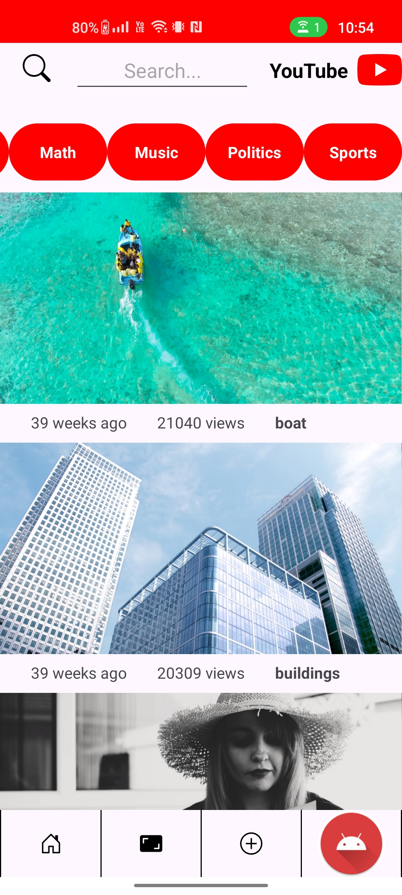 | 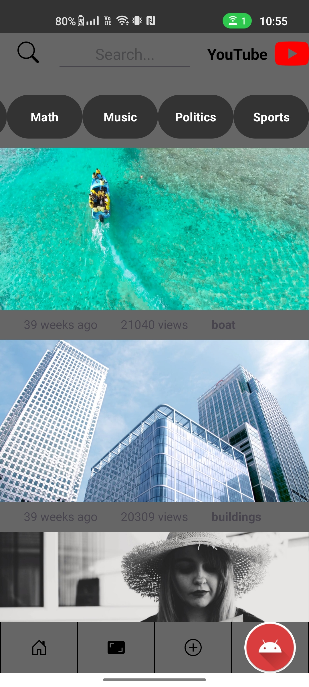 | 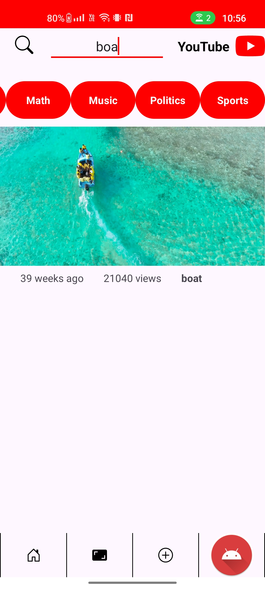 |
|:------------------------------------------------------------:|:------------------------------------------------------------:|:------------------------------------------------------------:|
| Home page standard | Dark mode | Search |

## Watch Video
The Watch Video page provides several useful features, including:

* A video list displaying all available videos on the platform.
* The ability to watch videos, pause, skip forward, and rewind.
* Options to add, edit, and delete comments.
* The ability to like or dislike videos.
* A view counter showing how many people have watched the video.

# Watch VideoViews

| 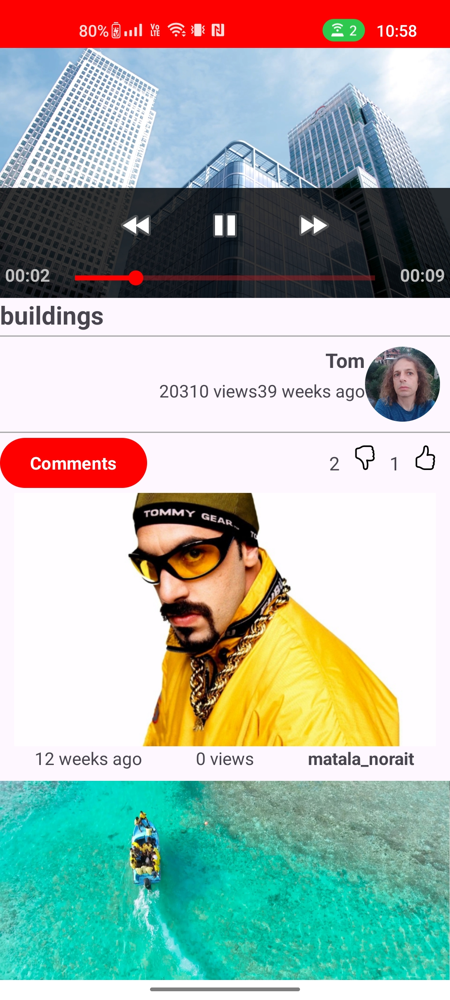 | 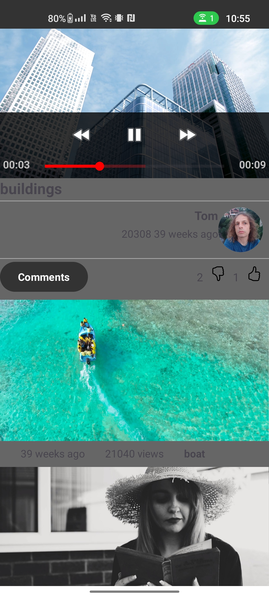 | 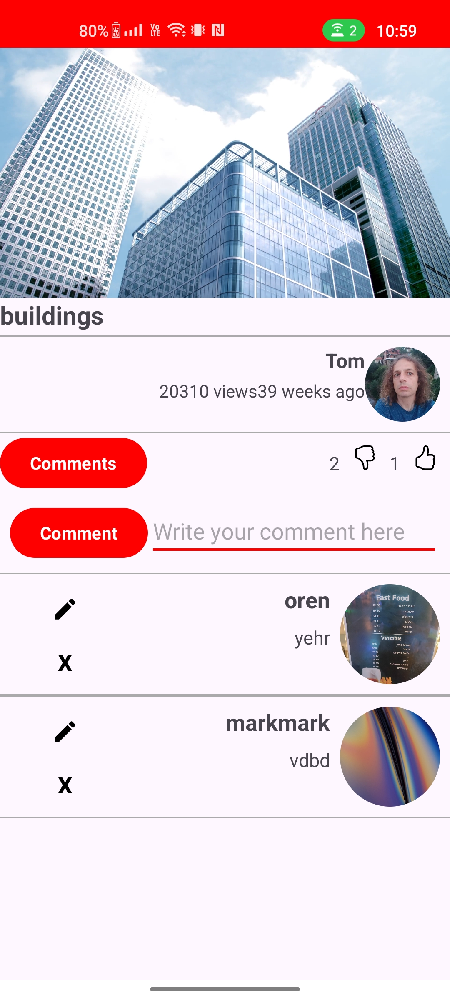 | 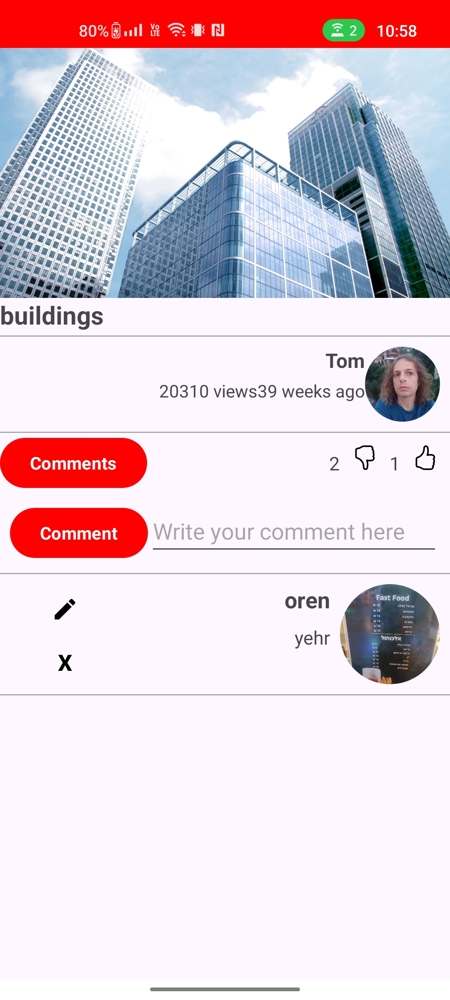 |
|:------------------------------------------------------------:|:------------------------------------------------------------:|:------------------------------------------------------------:|:------------------------------------------------------------:|
| Regular | Dark mode | Add comment | Erase comment |

## Sign In Page
The Sign Page allows you to log in to an existing one with the following validations:

* If the username is incorrect or does not exist, an alert will notify you that the user was not found.
* If the password is incorrect, an alert will notify you to check your password and try again.
* These validations ensure that account creation and login processes are secure and user-friendly.

# Sign In Views

| 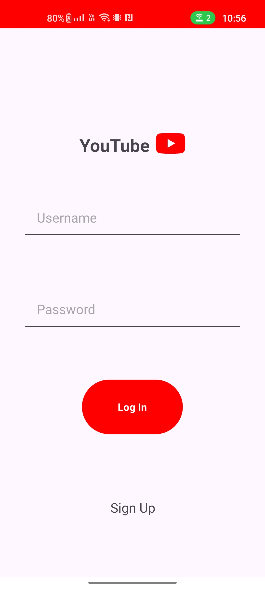 | 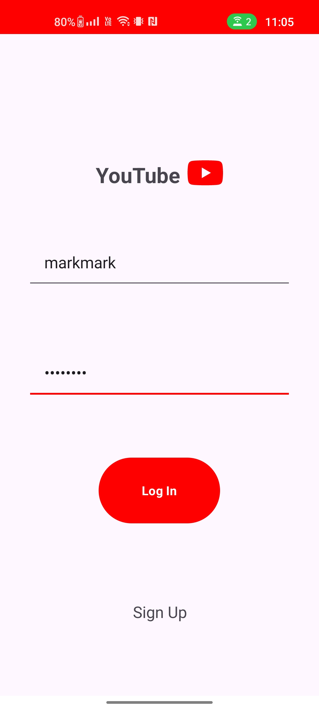 | 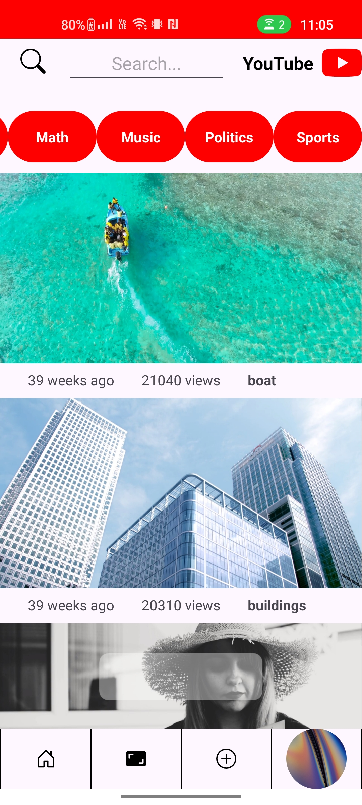 |
|:------------------------------------------------------------:|:------------------------------------------------------------:|:------------------------------------------------------------:|
| Regular | Sign in | You can see the user's photo after signing in |

## Sign UP Page
The Sign Up Page allows users to create a new account with the following features:

* Username Availability: If the username is already taken, an alert will notify the user to choose a different name.
* Password Strength: If the password is too weak, an alert will suggest creating a stronger password (e.g., using a mix of letters, numbers, and special characters).
* Password Confirmation: If the password does not match the confirmation field, an alert will notify the user to re-enter the passwords.
* User-Friendly Design: The interface is intuitive, making the sign-up process smooth and efficient, with clear guidance at each step.
* User Photo: Users can upload a profile picture during sign-up, making the experience more personalized.

# Sign Up Views

| 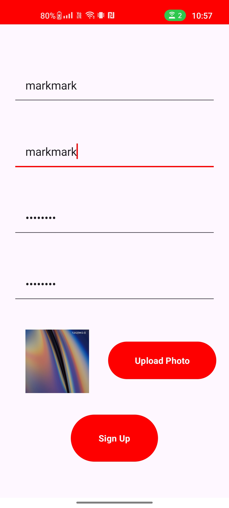 | 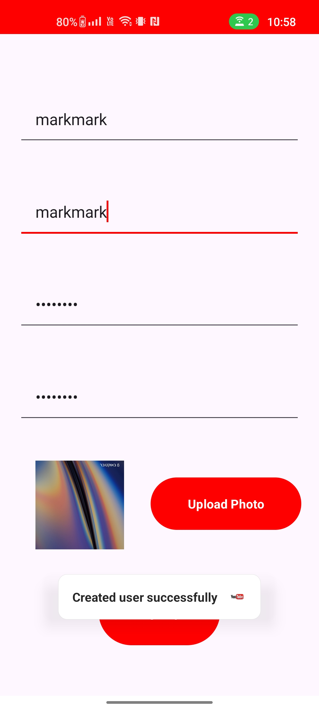 |  |
|:------------------------------------------------------------:|:------------------------------------------------------------:|:------------------------------------------------------------:|
| Sign up page | Success message after account creation | Profile photo displayed after signing up |

## Add Video Page
The Add Video Page allows users to upload and manage their videos with the following features:

* Add Video Details: Users can add the name of the video, a thumbnail image, and the video file itself.
* View Uploaded Videos: Users can see all the videos they have previously uploaded in a list.
* Delete Videos: Users have the option to delete any video they have uploaded.
* Add More Videos: Users can upload additional videos at any time.

This page provides an easy way to manage and update video content, making it simple for users to organize their uploaded videos.

# Add Video Views

|  | 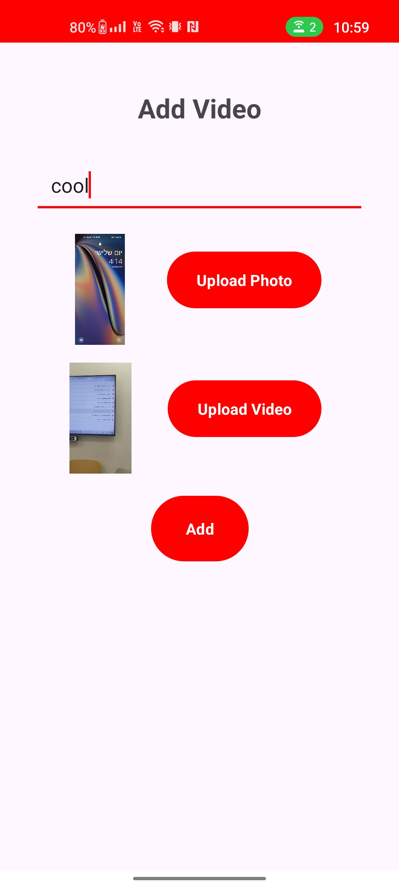 | 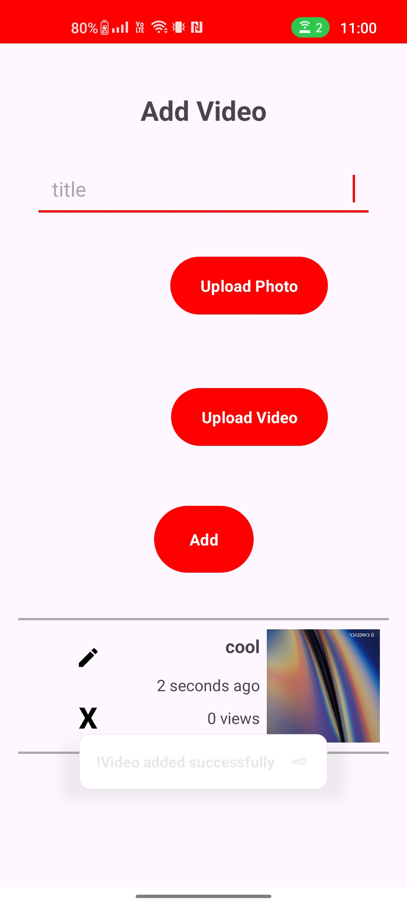 |
|:------------------------------------------------------------:|:------------------------------------------------------------:|:------------------------------------------------------------:|
| Add video page | Choose the video, name, and thumbnail | Video added |

## Profile Page
The Profile Page allows users to manage their account and videos with the following features:

* View User Details: Users can see their profile information, including their username and profile picture.
* Edit Username: Users can change their username directly from the profile page.
* View Uploaded Videos: Users can view all the videos they have uploaded.
* Delete Videos: Users have the ability to delete any of their uploaded videos.
* Sign Out: Users can sign out of their account from this page.
This page provides users with full control over their profile and uploaded content, making it easy to manage their account and media.

# Profile Views

| 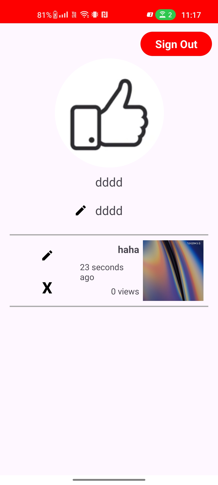 | 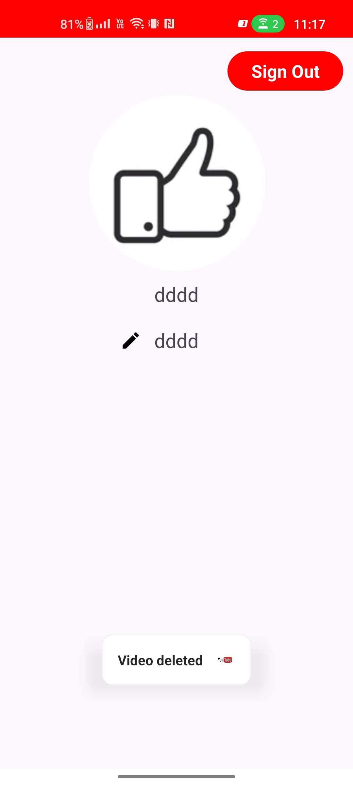 |
|:------------------------------------------------------------:|:------------------------------------------------------------:|
| Profile Page | Deleting video from the profile page |

## Delete video explain

# Delete video Views

## Add video explain

# Add video Views

## Edit video explain

# Edit video Views